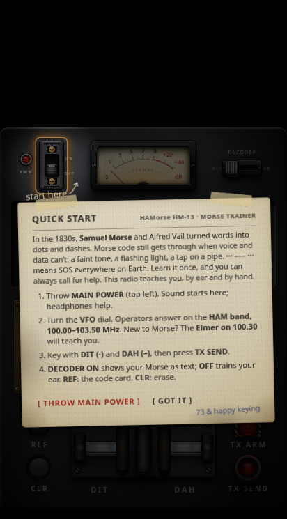
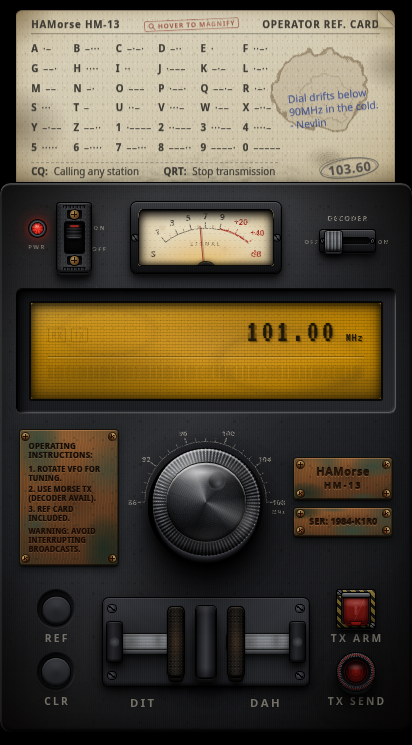
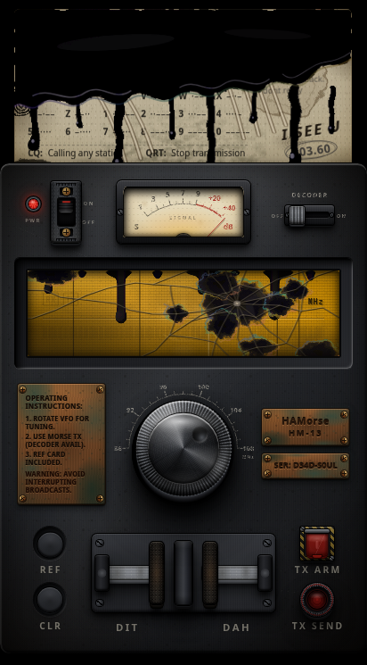

# HAMorse

**Learn Morse code on a painfully realistic old ham radio.**
Tune the dial, key the paddles and talk to the operators on the band.
Just don't answer the frequency that answers back.

*An entry for the Costume Contest track of Kiroween 2026.*

**▶ Play it: <https://einsajo.github.io/HAMorse/>** (best on a phone, with headphones)

[](https://github.com/einsajo/HAMorse/actions/workflows/ci.yml)

| The Quick Start note | A Morse trainer… | …until it isn't |
|---|---|---|
|  |  |  |

*Every pixel is CSS and SVG, and every sound is synthesised live. There are no images or audio files in the app.*

---

## What it is

On the surface, it's a calm, useful Morse trainer built as a heavy 1970s
transceiver: a brushed-metal chassis, an amber LCD, an S-meter, a weighted
VFO dial, a twin-lever Morse key and a dog-eared operator's card tucked behind the
set. Everything you see is drawn with CSS and SVG, and everything you hear is
synthesised live with the Web Audio API. There are no images and no sound files.

Underneath, it's a horror story told by the radio's own parts. Somewhere on
the dial is a frequency that isn't on any list. It is somewhere new every
time the radio is reset, and the last operator pencilled it on his card.
Once it has called you, the radio won't let you go.

## How to play

1. **Throw MAIN POWER** (the breaker, top left). Audio only starts here,
   because phones don't allow autoplay.
2. **Turn the VFO dial.** 88–108 MHz:
   | Frequency | What's there |
   |---|---|
   | 89.30 · 93.50 · 98.10 | News, sports and jazz broadcasts (live streams, through a vintage AM chain) |
   | 90.20 | **The Guide**: a friendly ham who points beginners at the tutors |
   | 100.00 – 103.50 | **The ham band**: Morse stations to learn with |
   | 100.30 | **The Elmer** (mentor): introduces himself, asks if you're new, then teaches |
   | 101.00 | Practice station: HI, then SOS |
   | 101.70 | Code-practice bulletin: slow text to copy by ear |
   | 102.40 | **Bob**: a real-feeling QSO (RST, name, QTH, 73) |
   | 102.75 | **The Stranger**: a different ragchewer every boot |
   | 103.10 | **Sam**: high-speed copy practice in 5-character groups |
   | ??? | Something else |
3. **Key with the paddles**: **DIT** (left) and **DAH** (right). Arm **TX**
   and press **TX SEND** to transmit your over. Keyboard works too: Tab to a
   paddle, then press Enter or Space.
4. **REF** slides the reference card out. It belonged to the last operator: read it closely. Hold it (touch) or hover over it
   (mouse) to read it through the loupe.
5. **DECODER ON/OFF**: beginners see what they key and what they hear.
   Switch it off to copy by ear and build real speed.

> **Photosensitivity:** the haunt uses low-contrast flicker at no more than 3 flashes per
> second, plus one bright flash at the jumpscare. With *reduce motion* turned on,
> the animations are calmed down.
> **Headphones recommended.**

## Run it

```bash
npm install
npm run dev        # http://localhost:5173
npm run build      # type-check and production build into dist/
npm test           # 53 unit tests: Morse timing, stations, agents, the agent route, the streams power
```

### Optional: live AI operators

The Guide, the Stranger and the Ghost run on built-in local "brains" by
default, so the app works offline. To let a real LLM play them, run the
small agent route. It keeps your API key on the server, never in the
browser:

```bash
cp .env.example .env              # then put your Groq key in AGENT_LLM_KEY
node --env-file=.env server/agent-route.mjs
npm run dev                       # .env also sets VITE_AGENT_URL for the app
```

- The default is [Groq](https://console.groq.com) running `qwen/qwen3.8-27b`: one fast reply per turn,
  with thinking switched off. Any OpenAI-compatible provider works (OpenAI, Gemini and others)
  if you set `AGENT_LLM_URL` and `AGENT_LLM_MODEL`.
- Every persona keeps to the on-air rules, which the server adds itself: stay in
  character, and reply in short upper-case CW shorthand the radio can actually key.
- `.env` is git-ignored. **Never commit a real key.**
- If the route is unreachable or slow (more than 6 s), nothing breaks: the
  operator's signal fades out (`QSB... QSB... LOST SIG`), and you can call again.
- To go back to the offline local brains, leave `VITE_AGENT_URL` empty.

## Built with Kiro

The whole project was specified, built and verified with [Kiro](https://kiro.dev):

- **Spec**: [`.kiro/specs/hamorse/`](.kiro/specs/hamorse/) holds the
  requirements, the design and the task list, kept up to date with every change.
- **Steering**: [`.kiro/steering/`](.kiro/steering/) holds the product vision ("earn the scare")
  and the hard rules: the tech stack, mobile-first behaviour and the skeuomorphic visual language.
- **Hooks**: [`validate-morse`](.kiro/hooks/validate-morse.json) re-checks every
  A–Z / 0–9 code against ITU Morse whenever the dictionary is saved. The decoder and the
  printed card both read that one dictionary, so they can never disagree.
- **Powers**:
  - [`morse-validator`](.kiro/powers/morse-validator/) checks the codes.
  - [`live-streams`](.kiro/powers/live-streams/) finds radio streams for the broadcast slots and verifies they
    actually play in a browser (audio, CORS, HTTPS).
- **Playwright (MCP)**: visual and timing checks at phone size. This covered every
  stage of the haunt, flicker timing measured frame by frame (≤ 3 per second),
  the stinger's loudness, and the card's rot.

## Under the hood

- **Stack:** React 18, TypeScript and Vite with plain CSS. No UI libraries and no 3D.
- **Audio:** everything is synthesised with Web Audio:
  - a 700 Hz sidetone and band static with QSB fading;
  - physically modelled switch, card and breaker sounds;
  - the ghost's drone;
  - a horror stinger behind its own limiter, so it can never clip.
- **Agents:** a multi-agent engine ([`agentEngine.ts`](src/utils/agentEngine.ts)) runs each persona's
  memory and turns. The ghost is a real agent that decides when to strike.
- **Phones:** portrait-first.
  - Pinch-zoom and pull-to-refresh are blocked while you key.
  - Your phone gives haptic feedback where it's supported.
  - Audio recovers after calls and app switches, and sleeps while the tab is hidden.

## License

See [LICENSE](LICENSE). The VT323 font is under the SIL Open Font License; see
[`public/fonts/VT323-OFL.txt`](public/fonts/VT323-OFL.txt).
