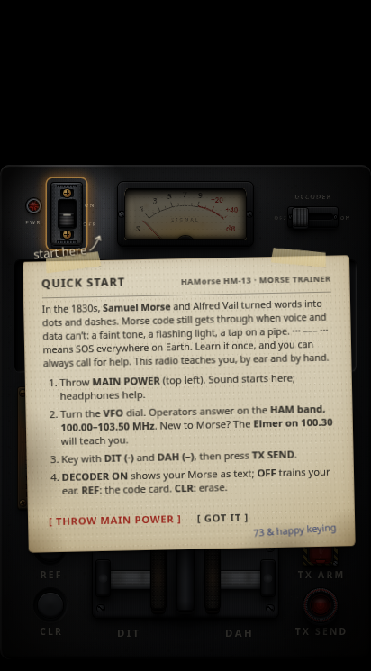
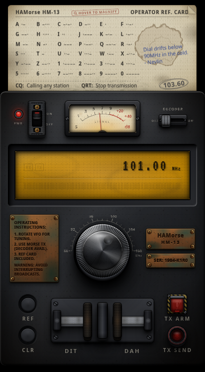
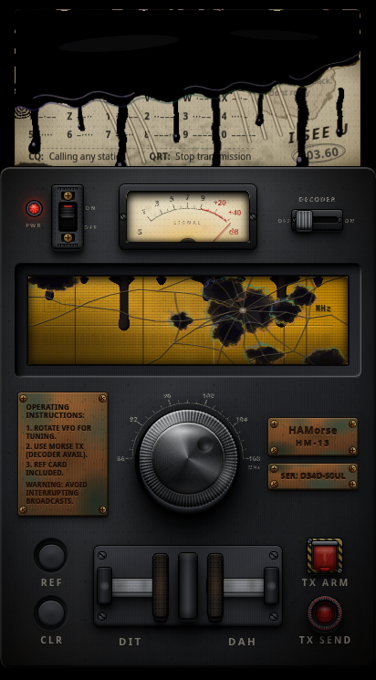
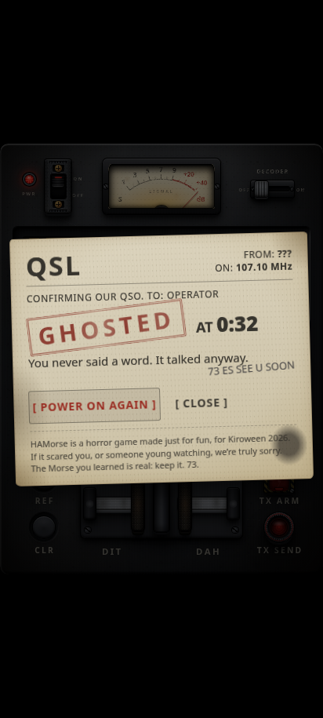

# HAMorse

**Learn Morse on a ham radio that answers back.**
A painfully realistic 1970s transceiver that teaches you Morse code —
and something on the band has learned it too.

*Kiroween 2026 · Costume Contest*

**▶ Play it: <https://einsajo.github.io/HAMorse/>** — best on a phone, with headphones.

[](https://github.com/einsajo/HAMorse/actions/workflows/ci.yml)

| The Quick Start note | A Morse trainer… | …until it isn't | …and it sends you a card |
|---|---|---|---|
|  |  |  |  |

*No image files. No audio files. Every pixel is CSS and SVG; every sound is synthesised live.*

---

## Try it in one minute

1. **Throw MAIN POWER** (top left). Sound starts here — headphones on.
2. Press **REF** and read the card. Someone pencilled a frequency in the corner.
3. **Tune to it. Wait.** It calls you, like any operator.
4. Answer it — or just listen. You have about **45 seconds**.

## Learn Morse properly

- **The Elmer on 100.30** teaches beginners letter by letter. A practice station,
  a slow bulletin, **Bob** (a real-feeling QSO) and **Sam** (speed drills) train
  the rest. The **Guide on 90.20** points you around. News, sports and jazz play
  on 89.30 / 93.50 / 98.10.
- Every paddle press sounds the **real 700 Hz dit or dah**, with a tick of
  vibration. Replies come back at a readable **15 WPM**.
- **Your progress is pencilled on the card:** a tick by every letter the Elmer
  has taught you, and your best speed.
- **TX GBL** puts you on the air with anyone else tuned to the same frequency,
  person to person (local relay today; a public relay is the next step).
- The **decoder** shows what you key and what you hear. Switch it off and copy
  by ear, like real CW.

## Run it

```bash
npm install
npm run dev     # http://localhost:5173
npm test        # 63 unit tests
```

**Live AI operators (optional):** the Guide, the Stranger and the Ghost run on
built-in local brains by default. To let a real LLM play them (Groq
`qwen/qwen3.8-27b`), run the small agent route — the key stays on the server:

```bash
cp .env.example .env   # add AGENT_LLM_KEY
node --env-file=.env server/agent-route.mjs
```

## Verified, in numbers

- A judge who never keys reaches the jumpscare in **~44 s**; a conversation takes ~2 min.
- One bright flash; flicker at most **3 per second**, checked frame by frame (WCAG 2.3.1).
- The jumpscare's measured peak is **0.96 full scale**: loud, never clipping.
- **63 unit tests** plus CI (type check, build, tests, Morse validator) on every PR.

Method and measurements: **[docs/VERIFICATION.md](docs/VERIFICATION.md)**.

## Built with Kiro

Specified, built and verified with [Kiro](https://kiro.dev): the spec
([`.kiro/specs/hamorse/`](.kiro/specs/hamorse/), ~115 tasks) stayed the source
of truth across 48 PRs; steering kept the vision ("earn the scare"); a hook
re-validates the Morse dictionary on every save; two powers validate codes and
provision the live streams; Playwright (MCP) measured the UI frame by frame.

The full story — including the honest review that changed the product:
**[docs/HOW-KIRO-BUILT-THIS.md](docs/HOW-KIRO-BUILT-THIS.md)**.

## Under the hood

React 18, TypeScript, Vite, plain CSS. No UI libraries, no 3D, no assets.
All audio is Web Audio: the sidetone, band static with fading, physically
modelled switch and paper Foley, the ghost's drone, and a double-hit horror
stinger behind a safety limiter. Portrait-first, with haptics where supported.

> **Photosensitivity:** one bright flash; flicker ≤ 3/s; calmer with *reduce motion*.

## License

[MIT](LICENSE). The VT323 font is under the SIL OFL; see
[`public/fonts/VT323-OFL.txt`](public/fonts/VT323-OFL.txt).
